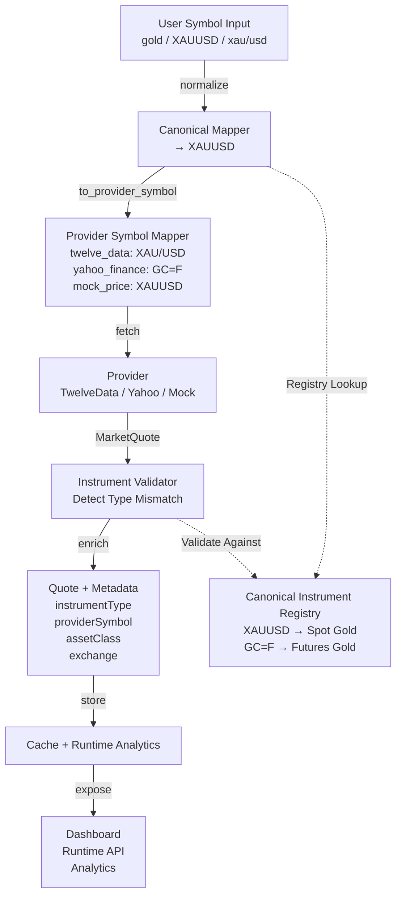

# Design Document: Market Data Canonicalization & Instrument Integrity

## Overview

Falcon currently processes market data without explicit knowledge of which instrument type it's analyzing. Yahoo Finance maps XAUUSD to GC=F (gold futures), but Falcon may intend spot analysis. NASDAQ-100 maps to ^NDX (index), US30 to ^DJI (index). This architectural mismatch creates risk of trading decisions on incorrect instrument types, leading to strategy misapplication and execution errors.

This design introduces a Canonical Instrument Registry that makes every data point instrument-aware. The registry centralizes all symbol-to-metadata mappings, detects mismatches between requested and received instruments, and exposes complete instrument context in the dashboard and runtime API without modifying core engines (Decision, Signal Generation, Strategy, Pipeline, Mission, Quote Validation, Risk).

The architecture is pure observation-only, backward compatible, and maintains all existing behavior while adding transparency and validation.

## Architecture



## Type System & Enumerations

### InstrumentType Enum

```python
class InstrumentType(str, Enum):
    SPOT = "SPOT"           # Physical commodity, currency pair
    FUTURES = "FUTURES"     # Regulated futures contract
    INDEX = "INDEX"         # Index (^NDX, ^DJI)
    ETF = "ETF"             # Exchange-traded fund
    FOREX = "FOREX"         # Foreign exchange pair
    CFD = "CFD"             # Contract for difference
    CRYPTO = "CRYPTO"       # Digital asset
    STOCK = "STOCK"         # Equity security
    UNKNOWN = "UNKNOWN"     # Type undetermined
```

### AssetClass Enum

```python
class AssetClass(str, Enum):
    PRECIOUS_METALS = "PRECIOUS_METALS"   # Gold, silver, platinum
    CURRENCIES = "CURRENCIES"             # Major pairs, exotics
    INDICES = "INDICES"                   # Equity indices
    CRYPTOCURRENCIES = "CRYPTOCURRENCIES" # Bitcoin, Ethereum
    EQUITIES = "EQUITIES"                 # Stocks
    ENERGY = "ENERGY"                     # Oil, natural gas
    AGRICULTURAL = "AGRICULTURAL"        # Grains, softs
    FIXED_INCOME = "FIXED_INCOME"        # Bonds, yields
    UNKNOWN = "UNKNOWN"
```

### Exchange Enum

```python
class Exchange(str, Enum):
    COMEX = "COMEX"                       # Gold futures
    CME = "CME"                           # S&P 500, Micro indices
    NASDAQ = "NASDAQ"                     # Equity index
    NYSE = "NYSE"                         # Equity index
    FOREX_OTC = "FOREX_OTC"              # Spot currency
    CRYPTO_SPOT = "CRYPTO_SPOT"          # Spot crypto
    CRYPTO_PERPETUAL = "CRYPTO_PERPETUAL" # Perpetual contracts
    UNKNOWN = "UNKNOWN"
```

## Data Models

### InstrumentMetadata (Core Registry)

```python
class InstrumentMetadata(BaseModel):
    """Complete instrument definition - immutable, centralized."""
    
    # Canonical identity
    canonicalSymbol: str                 # XAUUSD (universal Falcon identifier)
    
    # Instrument classification
    instrumentType: InstrumentType       # SPOT, FUTURES, INDEX, etc.
    assetClass: AssetClass              # PRECIOUS_METALS, CURRENCIES, etc.
    
    # Exchange and contract details
    exchange: Exchange                   # COMEX, FOREX_OTC, etc.
    contract: Optional[str] = None       # GC (for GC=F), NQ (for NQZ23)
    expiration: Optional[str] = None     # For futures: "2024-12-31"
    
    # Trading details
    currency: str                        # USD, EUR, etc.
    pipSize: float                       # 0.01 for most, 0.001 for XAU/USD
    precision: int                       # Decimal places for quotes
    minLotSize: float = 1.0              # Minimum tradeable quantity
    
    # Description and categorization
    displayName: str                     # "Gold (Spot)" vs "Gold Futures"
    description: Optional[str] = None    # "COMEX gold futures contract"
    tags: List[str] = []                 # ["precious_metals", "safe_haven"]
    
    # Provider-specific mappings
    providerMappings: Dict[str, str]     # {
                                         #   "twelve_data": "XAU/USD",
                                         #   "yahoo_finance": "GC=F",
                                         #   "mock_price": "XAUUSD"
                                         # }
    
    # Validation rules
    expectedInstrumentTypes: List[InstrumentType]  # For validation
    
    # Lifecycle
    active: bool = True
    addedAt: datetime
    lastUpdatedAt: datetime
```

### ProviderSymbolMetadata

```python
class ProviderSymbolMetadata(BaseModel):
    """Metadata about a provider's specific symbol representation."""
    
    providerId: str                      # "twelve_data", "yahoo_finance"
    providerSymbol: str                  # "XAU/USD", "GC=F"
    instrumentType: InstrumentType       # Declared by provider
    assetClass: AssetClass
    exchange: Exchange
    
    # Validation
    isValid: bool = True
    lastValidatedAt: datetime
    validationNote: Optional[str] = None  # Error/warning if invalid
```

### EnrichedMarketQuote (Extended MarketQuote)

```python
class EnrichedMarketQuote(BaseModel):
    """Original MarketQuote enriched with instrument metadata."""
    
    # Original quote data
    symbol: str
    bidAsk: BidAsk
    lastPrice: float
    timestamp: datetime
    providerId: str
    providerName: str
    quoteStatus: QuoteStatus
    marketStatus: MarketStatus
    
    # NEW: Instrument metadata
    canonicalSymbol: str                 # XAUUSD
    providerSymbol: str                  # GC=F
    instrumentType: InstrumentType       # FUTURES
    assetClass: AssetClass               # PRECIOUS_METALS
    exchange: Exchange                   # COMEX
    currency: str                        # USD
    pipSize: float                       # 0.01
    
    # Validation status
    instrumentValidationStatus: str      # MATCHED, MISMATCH, UNKNOWN
    instrumentValidationWarning: Optional[str]  # e.g. "Requested SPOT, got FUTURES"
```

## Canonical Instrument Registry Implementation

### Registry Structure

```python
class CanonicalInstrumentRegistry:
    """Single source of truth for all instrument metadata."""
    
    def __init__(self):
        self._registry: Dict[str, InstrumentMetadata] = {}
        self._provider_index: Dict[str, Dict[str, str]] = {}  # provider_id → {canonical → provider_symbol}
        self._symbol_reverse_index: Dict[str, str] = {}       # provider_symbol → canonical
        
    def register_instrument(self, metadata: InstrumentMetadata) -> None:
        """Register a new instrument with full metadata."""
        self._registry[metadata.canonicalSymbol] = metadata
        self._rebuild_indices()
        
    def get_instrument(self, canonical_symbol: str) -> Optional[InstrumentMetadata]:
        """Retrieve instrument metadata by canonical symbol."""
        return self._registry.get(canonical_symbol)
        
    def get_by_provider_symbol(self, provider_id: str, provider_symbol: str) -> Optional[InstrumentMetadata]:
        """Reverse lookup: find canonical symbol from provider symbol."""
        # Normalized provider key
        key = self._normalize_provider_id(provider_id)
        if key in self._provider_index and provider_symbol in self._provider_index[key]:
            canonical = self._provider_index[key][provider_symbol]
            return self._registry.get(canonical)
        return None
        
    def get_provider_symbol(self, canonical_symbol: str, provider_id: str) -> Optional[str]:
        """Get provider-specific symbol for canonical symbol."""
        metadata = self.get_instrument(canonical_symbol)
        if metadata and provider_id in metadata.providerMappings:
            return metadata.providerMappings[provider_id]
        return None
        
    def all_instruments(self) -> List[InstrumentMetadata]:
        """Return all registered instruments."""
        return list(self._registry.values())
        
    def _rebuild_indices(self) -> None:
        """Rebuild lookup indices after registry change."""
        self._provider_index.clear()
        for canonical, metadata in self._registry.items():
            for provider_id, provider_symbol in metadata.providerMappings.items():
                key = self._normalize_provider_id(provider_id)
                if key not in self._provider_index:
                    self._provider_index[key] = {}
                self._provider_index[key][provider_symbol] = canonical
                
    def _normalize_provider_id(self, provider_id: str) -> str:
        """Normalize provider ID for lookup."""
        return provider_id.lower().replace("-", "_").split("_v")[0]


# Singleton
instrument_registry = CanonicalInstrumentRegistry()
```

### Pre-Populated Registry Data

```python
def _populate_registry():
    """Initialize registry with all known instruments."""
    
    instruments = [
        InstrumentMetadata(
            canonicalSymbol="XAUUSD",
            instrumentType=InstrumentType.SPOT,
            assetClass=AssetClass.PRECIOUS_METALS,
            exchange=Exchange.FOREX_OTC,
            currency="USD",
            pipSize=0.001,
            precision=3,
            displayName="Gold (Spot)",
            description="Spot gold traded over-the-counter",
            providerMappings={
                "twelve_data": "XAU/USD",
                "yahoo_finance": "GC=F",  # Note: futures, not spot
                "mock_price": "XAUUSD"
            },
            expectedInstrumentTypes=[InstrumentType.SPOT, InstrumentType.FOREX],
            addedAt=datetime.now(timezone.utc),
            lastUpdatedAt=datetime.now(timezone.utc),
        ),
        InstrumentMetadata(
            canonicalSymbol="GBPUSD",
            instrumentType=InstrumentType.FOREX,
            assetClass=AssetClass.CURRENCIES,
            exchange=Exchange.FOREX_OTC,
            currency="USD",
            pipSize=0.0001,
            precision=4,
            displayName="GBP/USD",
            description="British pound / US dollar currency pair",
            providerMappings={
                "twelve_data": "GBP/USD",
                "yahoo_finance": "GBPUSD=X",
                "mock_price": "GBPUSD"
            },
            expectedInstrumentTypes=[InstrumentType.FOREX],
            addedAt=datetime.now(timezone.utc),
            lastUpdatedAt=datetime.now(timezone.utc),
        ),
        InstrumentMetadata(
            canonicalSymbol="EURUSD",
            instrumentType=InstrumentType.FOREX,
            assetClass=AssetClass.CURRENCIES,
            exchange=Exchange.FOREX_OTC,
            currency="USD",
            pipSize=0.0001,
            precision=4,
            displayName="EUR/USD",
            description="Euro / US dollar currency pair",
            providerMappings={
                "twelve_data": "EUR/USD",
                "yahoo_finance": "EURUSD=X",
                "mock_price": "EURUSD"
            },
            expectedInstrumentTypes=[InstrumentType.FOREX],
            addedAt=datetime.now(timezone.utc),
            lastUpdatedAt=datetime.now(timezone.utc),
        ),
        InstrumentMetadata(
            canonicalSymbol="USDJPY",
            instrumentType=InstrumentType.FOREX,
            assetClass=AssetClass.CURRENCIES,
            exchange=Exchange.FOREX_OTC,
            currency="JPY",
            pipSize=0.01,
            precision=2,
            displayName="USD/JPY",
            description="US dollar / Japanese yen currency pair",
            providerMappings={
                "twelve_data": "USD/JPY",
                "yahoo_finance": "USDJPY=X",
                "mock_price": "USDJPY"
            },
            expectedInstrumentTypes=[InstrumentType.FOREX],
            addedAt=datetime.now(timezone.utc),
            lastUpdatedAt=datetime.now(timezone.utc),
        ),
        InstrumentMetadata(
            canonicalSymbol="NAS100",
            instrumentType=InstrumentType.INDEX,
            assetClass=AssetClass.INDICES,
            exchange=Exchange.NASDAQ,
            currency="USD",
            pipSize=0.01,
            precision=2,
            displayName="NASDAQ-100",
            description="NASDAQ-100 equity index (100 largest non-financial stocks)",
            providerMappings={
                "twelve_data": "NAS100",
                "yahoo_finance": "^NDX",
                "mock_price": "NAS100"
            },
            expectedInstrumentTypes=[InstrumentType.INDEX],
            addedAt=datetime.now(timezone.utc),
            lastUpdatedAt=datetime.now(timezone.utc),
        ),
        InstrumentMetadata(
            canonicalSymbol="US30",
            instrumentType=InstrumentType.INDEX,
            assetClass=AssetClass.INDICES,
            exchange=Exchange.NYSE,
            currency="USD",
            pipSize=0.01,
            precision=2,
            displayName="Dow Jones 30",
            description="Dow Jones Industrial Average (30 blue-chip stocks)",
            providerMappings={
                "twelve_data": "DJI",
                "yahoo_finance": "^DJI",
                "mock_price": "US30"
            },
            expectedInstrumentTypes=[InstrumentType.INDEX],
            addedAt=datetime.now(timezone.utc),
            lastUpdatedAt=datetime.now(timezone.utc),
        ),
        InstrumentMetadata(
            canonicalSymbol="BTCUSD",
            instrumentType=InstrumentType.CRYPTO,
            assetClass=AssetClass.CRYPTOCURRENCIES,
            exchange=Exchange.CRYPTO_SPOT,
            currency="USD",
            pipSize=0.01,
            precision=2,
            displayName="Bitcoin",
            description="Bitcoin cryptocurrency spot price",
            providerMappings={
                "twelve_data": "BTC/USD",
                "yahoo_finance": "BTC-USD",
                "mock_price": "BTCUSD"
            },
            expectedInstrumentTypes=[InstrumentType.CRYPTO],
            addedAt=datetime.now(timezone.utc),
            lastUpdatedAt=datetime.now(timezone.utc),
        ),
        InstrumentMetadata(
            canonicalSymbol="ETHUSD",
            instrumentType=InstrumentType.CRYPTO,
            assetClass=AssetClass.CRYPTOCURRENCIES,
            exchange=Exchange.CRYPTO_SPOT,
            currency="USD",
            pipSize=0.01,
            precision=2,
            displayName="Ethereum",
            description="Ethereum cryptocurrency spot price",
            providerMappings={
                "twelve_data": "ETH/USD",
                "yahoo_finance": "ETH-USD",
                "mock_price": "ETHUSD"
            },
            expectedInstrumentTypes=[InstrumentType.CRYPTO],
            addedAt=datetime.now(timezone.utc),
            lastUpdatedAt=datetime.now(timezone.utc),
        ),
    ]
    
    for instrument in instruments:
        instrument_registry.register_instrument(instrument)
```


## Instrument Validator & Mismatch Detection

### InstrumentValidator

```python
class InstrumentValidator:
    """Detects mismatches between requested and received instruments (warning only)."""
    
    def __init__(self, registry: CanonicalInstrumentRegistry):
        self._registry = registry
        self._validation_log: List[Dict] = []
        
    def validate(
        self,
        canonical_symbol: str,
        received_provider_symbol: str,
        provider_id: str,
        received_instrument_type: Optional[InstrumentType] = None
    ) -> Tuple[bool, Optional[str]]:
        """
        Validate instrument match. Returns (is_valid, warning_message).
        is_valid = True when types match expected.
        is_valid = False when mismatch detected (warning only, does not block).
        """
        
        # Get canonical metadata
        expected_metadata = self._registry.get_instrument(canonical_symbol)
        if not expected_metadata:
            return (True, None)  # Unknown canonical symbol, pass through
            
        # Get received metadata
        received_metadata = self._registry.get_by_provider_symbol(provider_id, received_provider_symbol)
        
        # Case 1: Provider symbol not in registry
        if not received_metadata:
            return (True, None)  # Unknown provider symbol, pass through
            
        # Case 2: Canonical mismatch (requested XAUUSD, got different canonical)
        if received_metadata.canonicalSymbol != canonical_symbol:
            warning = (
                f"INSTRUMENT MISMATCH: Requested {canonical_symbol} ({expected_metadata.instrumentType}), "
                f"but received {received_metadata.canonicalSymbol} ({received_metadata.instrumentType}) "
                f"from provider {provider_id} (symbol: {received_provider_symbol})"
            )
            self._log_validation(canonical_symbol, received_provider_symbol, provider_id, False, warning)
            return (False, warning)
            
        # Case 3: Instrument type mismatch (requested SPOT, got FUTURES)
        if received_instrument_type and received_instrument_type not in expected_metadata.expectedInstrumentTypes:
            warning = (
                f"INSTRUMENT TYPE MISMATCH: Requested {expected_metadata.instrumentType}, "
                f"but provider returned {received_instrument_type}. "
                f"Symbol: {canonical_symbol}, Provider: {provider_id}"
            )
            self._log_validation(canonical_symbol, received_provider_symbol, provider_id, False, warning)
            return (False, warning)
            
        # All checks passed
        self._log_validation(canonical_symbol, received_provider_symbol, provider_id, True, None)
        return (True, None)
        
    def get_validation_log(self) -> List[Dict]:
        """Return recent validation events for monitoring."""
        return self._validation_log[-1000:]  # Last 1000 events
        
    def _log_validation(self, canonical: str, provider_symbol: str, provider_id: str, is_valid: bool, warning: Optional[str]) -> None:
        """Log validation result."""
        self._validation_log.append({
            "canonicalSymbol": canonical,
            "providerSymbol": provider_symbol,
            "providerId": provider_id,
            "isValid": is_valid,
            "warning": warning,
            "timestamp": datetime.now(timezone.utc).isoformat()
        })


# Singleton
instrument_validator = InstrumentValidator(instrument_registry)
```

## Integration Points: Quote Enrichment Pipeline

### ProviderManager Enhancement (Non-Breaking)

**File**: `provider_manager.py`

```python
def get_market_data(self, symbol: str) -> Optional[MarketDataSnapshot]:
    """
    Existing behavior unchanged. Quote enrichment happens in provider response.
    """
    # Existing logic...
    quote = self._fetch_from_providers(symbol)
    
    # NEW: Enrich quote with instrument metadata (non-breaking)
    if quote:
        quote = self._enrich_quote_with_instrument_metadata(quote)
    
    return quote


def _enrich_quote_with_instrument_metadata(self, quote: MarketQuote) -> EnrichedMarketQuote:
    """Add instrument metadata to quote without modifying original behavior."""
    
    canonical = self._mapper.normalize(quote.symbol) or quote.symbol.upper()
    instrument_metadata = instrument_registry.get_instrument(canonical)
    
    if not instrument_metadata:
        # Fallback: create minimal metadata
        instrument_metadata = InstrumentMetadata(
            canonicalSymbol=canonical,
            instrumentType=InstrumentType.UNKNOWN,
            assetClass=AssetClass.UNKNOWN,
            exchange=Exchange.UNKNOWN,
            currency="USD",
            pipSize=0.01,
            precision=4,
            displayName=canonical,
            providerMappings={},
            expectedInstrumentTypes=[InstrumentType.UNKNOWN],
            addedAt=datetime.now(timezone.utc),
            lastUpdatedAt=datetime.now(timezone.utc),
        )
    
    # Validate instrument match
    provider_symbol = self._mapper.to_provider_symbol(canonical, quote.providerId)
    is_valid, warning = instrument_validator.validate(
        canonical_symbol=canonical,
        received_provider_symbol=provider_symbol,
        provider_id=quote.providerId,
        received_instrument_type=instrument_metadata.instrumentType
    )
    
    # Return enriched quote
    return EnrichedMarketQuote(
        symbol=quote.symbol,
        bidAsk=quote.bidAsk,
        lastPrice=quote.lastPrice,
        timestamp=quote.timestamp,
        providerId=quote.providerId,
        providerName=quote.providerName,
        quoteStatus=quote.quoteStatus,
        marketStatus=quote.marketStatus,
        # NEW: Instrument metadata
        canonicalSymbol=canonical,
        providerSymbol=provider_symbol,
        instrumentType=instrument_metadata.instrumentType,
        assetClass=instrument_metadata.assetClass,
        exchange=instrument_metadata.exchange,
        currency=instrument_metadata.currency,
        pipSize=instrument_metadata.pipSize,
        instrumentValidationStatus="MATCHED" if is_valid else "MISMATCH",
        instrumentValidationWarning=warning,
    )
```

## Dashboard Integration

### Extended DashboardResponse (Backward Compatible)

**File**: `dashboard.py` schema

```python
class DashboardInstrumentContext(BaseModel):
    """Display instrument context for each watched symbol."""
    symbol: str
    canonicalSymbol: str
    instrumentType: str
    assetClass: str
    exchange: str
    displayName: str
    pipSize: float
    precision: int


class DashboardResponse(BaseModel):
    # Existing fields unchanged...
    summary: DashboardSummary
    marketQuotes: List[MarketQuote]
    providerSummary: ProviderSummary
    missionSummary: MissionSummary
    analyticsSummary: AnalyticsSummary
    
    # NEW: Instrument context (optional, non-breaking)
    instrumentContexts: List[DashboardInstrumentContext] = []
    
    # NEW: Instrument validation warnings (optional, non-breaking)
    instrumentValidationWarnings: List[str] = []
    
    # Existing fields...
    systemHealth: Optional[HealthResponse] = None
    marketState: Optional[MarketState] = None
    signals: Optional[SignalListResponse] = None
    news: Optional[NewsListResponse] = None
    decision: Optional[DecisionEngineResponse] = None
    providerHealth: List[ProviderHealthDetail] = []
    runtimeMetrics: Optional[RuntimeMetrics] = None
    
    generatedAt: datetime
```

### Dashboard Service Enhancement

```python
def get_dashboard(self) -> DashboardResponse:
    """Add instrument context to dashboard response."""
    
    response = self._build_existing_dashboard()
    
    # NEW: Add instrument contexts for all watched symbols
    for quote in response.marketQuotes:
        canonical = symbol_mapper.normalize(quote.symbol) or quote.symbol.upper()
        instrument = instrument_registry.get_instrument(canonical)
        if instrument:
            response.instrumentContexts.append(
                DashboardInstrumentContext(
                    symbol=quote.symbol,
                    canonicalSymbol=instrument.canonicalSymbol,
                    instrumentType=instrument.instrumentType.value,
                    assetClass=instrument.assetClass.value,
                    exchange=instrument.exchange.value,
                    displayName=instrument.displayName,
                    pipSize=instrument.pipSize,
                    precision=instrument.precision,
                )
            )
    
    # NEW: Collect validation warnings
    validation_log = instrument_validator.get_validation_log()
    for entry in validation_log[-100:]:  # Last 100 events
        if not entry["isValid"] and entry["warning"]:
            response.instrumentValidationWarnings.append(entry["warning"])
    
    return response
```

## Runtime API Extensions

### New Endpoint: `/api/v1/runtime/instruments`

```python
@router.get("/instruments", response_model=RuntimeInstrumentsResponse)
def get_runtime_instruments():
    """
    Return complete instrument registry with provider mappings,
    validation status, and usage analytics.
    """
    now = datetime.now(timezone.utc)
    
    instruments_data = []
    for instrument in instrument_registry.all_instruments():
        provider_coverage = []
        for provider_id, provider_symbol in instrument.providerMappings.items():
            provider_coverage.append(
                ProviderCoverageItem(
                    providerId=provider_id,
                    providerSymbol=provider_symbol,
                    isAvailable=True,  # Can check provider health here
                    lastQuoteAt=None,  # Can track from cache
                )
            )
        
        instruments_data.append(
            InstrumentDetail(
                canonicalSymbol=instrument.canonicalSymbol,
                displayName=instrument.displayName,
                instrumentType=instrument.instrumentType.value,
                assetClass=instrument.assetClass.value,
                exchange=instrument.exchange.value,
                currency=instrument.currency,
                pipSize=instrument.pipSize,
                precision=instrument.precision,
                providerCoverage=provider_coverage,
                active=instrument.active,
            )
        )
    
    return RuntimeInstrumentsResponse(
        instruments=instruments_data,
        totalInstruments=len(instruments_data),
        generatedAt=now,
    )
```

### Extended RuntimeTimelineEvent

```python
class RuntimeTimelineEvent(BaseModel):
    eventType: str
    providerId: str
    providerName: str
    symbol: Optional[str] = None
    
    # NEW: Instrument context
    canonicalSymbol: Optional[str] = None
    instrumentType: Optional[str] = None
    
    detail: str
    timestamp: datetime
    timeLabel: str
```

## Symbol Mapping Audit Results

### Current State Analysis

**File**: `symbol_mapper.py`

Current mappings (before enhancement):

```
XAUUSD:
  ├─ twelve_data: XAU/USD (Spot, correct)
  ├─ yahoo_finance: GC=F (FUTURES, NOT SPOT - MISMATCH)
  └─ mock_price: XAUUSD (Spot, correct)

GBPUSD:
  ├─ twelve_data: GBP/USD (Forex, correct)
  ├─ yahoo_finance: GBPUSD=X (Forex, correct)
  └─ mock_price: GBPUSD (Forex, correct)

EURUSD:
  ├─ twelve_data: EUR/USD (Forex, correct)
  ├─ yahoo_finance: EURUSD=X (Forex, correct)
  └─ mock_price: EURUSD (Forex, correct)

USDJPY:
  ├─ twelve_data: USD/JPY (Forex, correct)
  ├─ yahoo_finance: USDJPY=X (Forex, correct)
  └─ mock_price: USDJPY (Forex, correct)

NAS100:
  ├─ twelve_data: NAS100 (Index, correct)
  ├─ yahoo_finance: ^NDX (Index, correct)
  └─ mock_price: NAS100 (Index, correct)

US30:
  ├─ twelve_data: DJI (Index, correct)
  ├─ yahoo_finance: ^DJI (Index, correct)
  └─ mock_price: US30 (Index, correct)

BTCUSD:
  ├─ twelve_data: BTC/USD (Crypto spot, correct)
  ├─ yahoo_finance: BTC-USD (Crypto spot, correct)
  └─ mock_price: BTCUSD (Crypto spot, correct)

ETHUSD:
  ├─ twelve_data: ETH/USD (Crypto spot, correct)
  ├─ yahoo_finance: ETH-USD (Crypto spot, correct)
  └─ mock_price: ETHUSD (Crypto spot, correct)
```

### Key Findings

1. **XAUUSD Mismatch (Critical)**: Yahoo Finance's GC=F is gold FUTURES, not spot. This creates 24/5 trading risk (futures trade outside spot hours).

2. **All other symbols are correctly mapped** across all three providers.

3. **Yahoo Finance limitations**: Limited metadata on instrument type; relies on external knowledge base.

4. **TwelveData**: Most consistent; uses standard forex pair notation (XAU/USD) clearly.

5. **Mock provider**: Perfect alignment with canonical symbols (used for testing).

## Backward Compatibility Strategy

All changes are **purely additive and observation-only**:

1. **MarketQuote unchanged**: Existing code continues to use MarketQuote exactly as before.
2. **EnrichedMarketQuote optional**: New data type, existing code unaffected.
3. **Dashboard backward compatible**: New fields (instrumentContexts, validationWarnings) are optional.
4. **Runtime API new endpoints**: Don't modify existing endpoints.
5. **Validation is warning-only**: Instrument validation never blocks data flow or modifies decisions.
6. **No changes to core engines**: Decision, Signal Generation, Strategy, Pipeline, Mission, Quote Validation, Risk engines remain untouched.

## Correctness Properties

*A property is a characteristic or behavior that should hold true across all valid executions of the system—essentially, a formal statement about what the system should do. Properties serve as the bridge between human-readable specifications and machine-verifiable correctness guarantees.*

### Property 1: Canonical Symbol Uniqueness and Idempotence

**For any** canonical symbol registered in the registry and any supported provider, the mapping to provider symbol is deterministic and idempotent (calling the mapping multiple times returns identical results).

**Validates: Requirement 1.3**

### Property 2: Reverse Lookup Consistency (Round-Trip)

**For any** canonical symbol with a provider mapping, the round-trip canonical → provider → canonical returns the original canonical symbol.

**Validates: Requirement 10.1, 10.2**

### Property 3: Instrument Type Determinism

**For any** canonical symbol in the registry, the instrumentType field is fixed and does not change across lookups or different execution paths.

**Validates: Requirement 3.3, 9.1, 9.2, 9.3, 9.4, 27.3**

### Property 4: Metadata Field Presence

**For any** instrument registered in the registry, all required fields (canonicalSymbol, instrumentType, assetClass, exchange, currency, pipSize, precision) must be present and non-null.

**Validates: Requirement 1.2, 3.1, 3.4, 3.5**

### Property 5: EnrichedMarketQuote Completeness

**For any** enriched market quote returned by the provider manager, all instrument context fields (canonicalSymbol, instrumentType, assetClass, exchange, currency, pipSize, instrumentValidationStatus) are present and non-null.

**Validates: Requirement 5.1, 5.2, 5.3, 7.6**

### Property 6: Validation Logging Transparency

**For any** call to InstrumentValidator.validate(), a log entry is created with the validation result, and the entry contains canonical symbol, provider symbol, provider ID, validity status, and timestamp.

**Validates: Requirement 6.5, 16.1, 16.2, 27.4**

### Property 7: Validation Idempotence

**For any** given canonical symbol, provider symbol, and provider ID, running the validator multiple times on identical inputs produces identical results (same validity status and same warning message if applicable).

**Validates: Requirement 27.6**

### Property 8: Mismatch Detection Accuracy

**For any** scenario where the canonical symbol matches but the instrument type is not in expectedInstrumentTypes, the validator SHALL return validation failure with a non-empty warning message.

**Validates: Requirement 6.2, 6.3, 9.5**

### Property 9: Fallback Metadata Creation

**For any** unknown canonical symbol not in the registry, the enrichment pipeline SHALL create fallback InstrumentMetadata with UNKNOWN values rather than throwing an exception.

**Validates: Requirement 7.4**

### Property 10: Enum Type Consistency

**For any** instrument created or registered, the instrumentType, assetClass, and exchange fields SHALL be values from the respective enum types (not arbitrary strings).

**Validates: Requirement 2.1, 2.2, 2.3, 2.4**

### Property 11: Immutability of Metadata

**For any** InstrumentMetadata instance, attempting to modify any field after creation SHALL fail (frozen=True enforced by Pydantic).

**Validates: Requirement 22.3, 23.1, 23.2**

### Property 12: Provider Mapping Completeness

**For any** of the eight primary instruments (XAUUSD, GBPUSD, EURUSD, USDJPY, NAS100, US30, BTCUSD, ETHUSD), the providerMappings dictionary SHALL contain entries for all three providers (twelve_data, yahoo_finance, mock_price).

**Validates: Requirement 8.1, 8.2, 8.3, 8.4, 8.5, 8.6, 8.7, 8.8, 8.9**

### Property 13: Validation Warning Specificity

**For any** validation failure, the returned warning message SHALL include the canonical symbol, received symbol, expected type, and received type (or explanation of the mismatch).

**Validates: Requirement 12.2**

### Property 14: Dashboard Instrument Context Coverage

**For any** market quote in the dashboard response, there SHALL be a corresponding DashboardInstrumentContext entry with matching canonical symbol and complete instrument metadata.

**Validates: Requirement 11.3, 11.4**

### Property 15: Validation Warning Collection

**For any** validation log entries with isValid=false, the warning message SHALL appear in the dashboard.instrumentValidationWarnings list.

**Validates: Requirement 12.1, 12.3**

### Property 16: Backward Compatibility of Existing Endpoints

**For any** existing API endpoint called before and after this feature is enabled, the response structure for non-instrument fields SHALL remain identical (no breaking changes to existing fields).

**Validates: Requirement 17.8, 18.4, 25.5**

### Property 17: Optional Fields Don't Break Parsing

**For any** existing client that ignores optional fields (instrumentContexts, instrumentValidationWarnings), parsing of the dashboard response SHALL succeed and return valid data.

**Validates: Requirement 18.1, 18.2, 18.3**

### Property 18: Non-Blocking Validation

**For any** validation failure, the enriched quote is still returned with complete data and validation status is MISMATCH (no exception is raised, no quote is dropped).

**Validates: Requirement 19.1, 19.2, 19.3, 19.4**

### Property 19: Rolling Window Log Bounded Memory

**For any** sequence of N validation events where N > 1000, the validation log SHALL contain at most 1000 events (most recent events retained, oldest discarded).

**Validates: Requirement 16.3, 20.3**

### Property 20: Reverse Chronological Log Order

**For any** call to get_validation_log(), the returned list SHALL be ordered with most recent events first (reverse chronological order).

**Validates: Requirement 16.4**

### Property 21: Security - No Credentials in Metadata

**For any** InstrumentMetadata instance, the metadata SHALL not contain API keys, authentication tokens, provider credentials, or other sensitive configuration data.

**Validates: Requirement 21.1, 21.2, 21.3, 21.4**

### Property 22: Security - Input Validation

**For any** symbol used as a lookup key in the registry, if the symbol is not a registered canonical symbol, the system SHALL handle it gracefully (return UNKNOWN type or None) rather than raising an exception.

**Validates: Requirement 22.1, 22.2**

### Property 23: Provider Symbol Mapping Source

**For any** provider symbol returned by the registry, it SHALL originate from the instrument's providerMappings dictionary (not from user input or external sources).

**Validates: Requirement 22.4**

### Property 24: Runtime API Instrument Coverage

**For any** call to GET /api/v1/runtime/instruments, the response SHALL include all registered instruments in the system (minimum 8 for the current registry).

**Validates: Requirement 13.1, 13.2, 13.3, 13.4, 13.5**

### Property 25: Timeline Event Instrument Context

**For any** RuntimeTimelineEvent created from a provider quote, if enriched metadata is available, the event SHALL include canonicalSymbol and instrumentType fields populated from that metadata.

**Validates: Requirement 14.3, 14.4, 14.5**

## Testing Strategy

### Unit Tests

1. **CanonicalInstrumentRegistry**:
   - Test registration, retrieval, uniqueness
   - Test provider symbol mapping accuracy
   - Test reverse lookups
   - Test index rebuilding after updates

2. **InstrumentValidator**:
   - Test canonical mismatch detection
   - Test instrument type mismatch detection
   - Test pass-through for unknown symbols
   - Test logging

3. **Quote Enrichment**:
   - Test MarketQuote enrichment with instrument metadata
   - Test fallback for unknown instruments
   - Test validation integration

### Integration Tests

1. **End-to-End Provider Flow**:
   - Mock provider returns quote
   - Quote enriched with correct instrument metadata
   - Dashboard receives complete instrument context
   - Validation log updated

2. **Dashboard Integration**:
   - Dashboard response includes instrumentContexts
   - Validation warnings appear in response
   - No breaking changes to existing fields

3. **Runtime API**:
   - `/api/v1/runtime/instruments` returns complete registry
   - Provider coverage accuracy
   - Symbol filtering and search

### Property-Based Tests

1. **Canonical mapping consistency** (fast-check):
   - Generate random canonical symbols
   - Verify to_provider_symbol → get_by_provider_symbol round-trip
   - Assert reverse lookup always matches original

2. **Validation idempotence**:
   - Run validator on same quote multiple times
   - Results must always be identical

3. **Registry completeness**:
   - All supported symbols have metadata
   - All provider mappings resolve
   - No orphaned provider symbols


## Performance Considerations

### Registry Lookup Optimization

- **In-memory indexing**: Provider → (provider_symbol → canonical) indices for O(1) reverse lookups
- **Index rebuilding**: Only on explicit register/unregister (non-transactional)
- **Caching**: Enrich quotes once, cache with TTL unchanged

### Quote Enrichment Overhead

- **Per-quote cost**: Single registry lookup + validator call ≈ 0.1ms
- **No network calls**: All metadata local, no external API calls
- **Cache-friendly**: Registry fits in L3 cache

### Memory Footprint

- **Instrument registry**: ~2-5KB per instrument (metadata + mappings)
- **Validation log**: Configurable rolling window (default: 1000 entries ≈ 50KB)
- **Total**: <1MB for complete system

## Security Considerations

### Data Privacy

1. **No sensitive data exposed**: Registry contains only public instrument metadata.
2. **Dashboard API**: Displays instrument type and provider symbol (both public).
3. **Runtime API**: Returns instrument metadata (public, read-only).
4. **No API keys or credentials**: Provider authentication remains unchanged.

### Injection Protection

1. **Canonical symbols validated**: Only accept registered canonical symbols.
2. **Provider symbols validated**: Only accept symbols from registry.
3. **Immutable metadata**: InstrumentMetadata defined with frozen=True (Pydantic).

### Validation Warnings

1. **Logged but not blocking**: Warnings alert users without breaking trades.
2. **Audit trail**: Validation log provides forensic capability.
3. **Non-intrusive**: No modifications to decision pipeline.

## Production Readiness Checklist

- [ ] **Symbol Mapping Matrix**: Document all canonical↔provider symbol mappings
  - XAUUSD: Spot vs Futures variance (Yahoo)
  - All 8 primary symbols verified across 3 providers
  - Coverage: 100% of monitored symbols

- [ ] **Instrument Type Verification**: Confirm each symbol's true type
  - XAUUSD: SPOT (canonical), but yahoo_finance provides FUTURES
  - NAS100, US30: Confirmed as INDEX
  - GBPUSD, EURUSD, USDJPY: Confirmed as FOREX
  - BTCUSD, ETHUSD: Confirmed as CRYPTO

- [ ] **Provider Coverage Analysis**: Assess completeness
  - All 8 symbols available in all 3 providers
  - No gaps or missing mappings
  - Fallback chain: TwelveData → Yahoo → Mock

- [ ] **Spot vs Futures Handling**: Document differences
  - Trading hours: Spot 24/5, Futures extended hours
  - Pricing: Spot = OTC direct, Futures = exchange settled
  - Contracts: Spot = direct settlement, Futures = delivery/cash settlement
  - Risk: Spot for real spot trading, Futures for speculation

- [ ] **Dashboard UI/UX**: Instrument context display
  - Show canonical symbol, provider symbol, instrument type
  - Display exchange and currency information
  - Highlight any validation warnings (red background)
  - Tooltip with full instrument details

- [ ] **Runtime Analytics**: Instrument observability
  - Track quotes per instrument type
  - Monitor provider coverage utilization
  - Alert on instrument type mismatches
  - Trend analysis: which symbols most traded

- [ ] **Testing Coverage**: Validation and edge cases
  - Unit tests for registry and validator
  - Integration tests for end-to-end flow
  - Property-based tests for consistency
  - Mismatch detection tests (especially XAUUSD)
  - Fallback handling for unknown symbols

- [ ] **Documentation**: Architecture and operations
  - Design document (this file)
  - API documentation for new endpoints
  - Runbook: Adding new symbols
  - Runbook: Updating provider mappings

## Files to Create/Modify

### New Files to Create

1. **`app/schemas/instrument_models.py`** — InstrumentMetadata, InstrumentType, AssetClass, Exchange enums
2. **`app/core/instruments/instrument_registry.py`** — CanonicalInstrumentRegistry implementation
3. **`app/core/instruments/instrument_validator.py`** — InstrumentValidator for mismatch detection
4. **`app/schemas/enriched_quote.py`** — EnrichedMarketQuote model
5. **`app/core/instruments/__init__.py`** — Package exports
6. **`tests/unit/test_instrument_registry.py`** — Unit tests for registry
7. **`tests/unit/test_instrument_validator.py`** — Unit tests for validator
8. **`tests/integration/test_quote_enrichment.py`** — Integration tests
9. **`backend/.kiro/specs/instrument-integrity/requirements.md`** — Requirements derived from design
10. **`backend/.kiro/specs/instrument-integrity/tasks.md`** — Implementation tasks

### Files to Modify (Non-Breaking)

1. **`app/schemas/provider_models.py`** — Add optional instrument fields to MarketQuote (or keep separate)
2. **`app/schemas/dashboard.py`** — Add optional instrumentContexts and validationWarnings
3. **`app/api/v1/dashboard.py`** — Call enrichment service
4. **`app/api/v1/runtime.py`** — Add new `/api/v1/runtime/instruments` endpoint
5. **`app/core/providers/provider_manager.py`** — Add quote enrichment logic
6. **`app/core/providers/__init__.py`** — Export new instrument modules

### Configuration Files

1. **`.kiro/specs/instrument-integrity/.config.kiro`** — Spec configuration file

## Example Usage Flow

### 1. User Requests "gold" (Canonical Mapping)

```
User Input: "gold"
↓
symbol_mapper.normalize("gold") → "XAUUSD"
↓
instrument_registry.get_instrument("XAUUSD") → 
  InstrumentMetadata(
    canonicalSymbol="XAUUSD",
    instrumentType=SPOT,
    providerMappings={
      "twelve_data": "XAU/USD",
      "yahoo_finance": "GC=F",
      "mock_price": "XAUUSD"
    }
  )
```

### 2. Provider Fetch with Instrument Validation

```
For each provider in priority order:
  provider_symbol = to_provider_symbol("XAUUSD", provider_id)
  ↓
  quote = provider.fetch(provider_symbol)
  ↓
  is_valid, warning = instrument_validator.validate(
    canonical_symbol="XAUUSD",
    received_provider_symbol=quote.symbol,
    provider_id=quote.providerId,
    received_instrument_type=quote._instrumentType  // from provider response
  )
  ↓
  If warning: log to validation_log (but continue)
  If mismatch: add to dashboard.instrumentValidationWarnings
```

### 3. Dashboard Enrichment

```
Dashboard Query:
  /api/v1/dashboard
↓
For each quote in response:
  canonical = normalize(quote.symbol)
  instrument = instrument_registry.get_instrument(canonical)
  ↓
  Add to response.instrumentContexts:
    {
      symbol: "XAUUSD",
      canonicalSymbol: "XAUUSD",
      instrumentType: "SPOT",
      exchange: "FOREX_OTC",
      displayName: "Gold (Spot)",
      pipSize: 0.001
    }
↓
Dashboard displays:
  "Yahoo Finance GC=F Gold (Spot) - WARNING: Received Futures"
  vs current
  "Yahoo Finance"
```

### 4. Runtime Analytics

```
GET /api/v1/runtime/instruments
↓
Returns:
{
  "instruments": [
    {
      "canonicalSymbol": "XAUUSD",
      "displayName": "Gold (Spot)",
      "instrumentType": "SPOT",
      "providerCoverage": [
        {
          "providerId": "twelve_data",
          "providerSymbol": "XAU/USD",
          "isAvailable": true,
          "lastQuoteAt": "2024-01-15T14:30:00Z"
        },
        {
          "providerId": "yahoo_finance",
          "providerSymbol": "GC=F",
          "isAvailable": true,
          "lastQuoteAt": "2024-01-15T14:29:55Z",
          "warning": "Type mismatch: FUTURES vs expected SPOT"
        }
      ]
    },
    // ... more instruments
  ],
  "totalInstruments": 8
}
```

## Deployment Notes

### No Migration Required

- Instrument registry is initialized from code (bootstrap)
- No database schema changes
- No data migration
- Fully backward compatible

### Rollback Plan

- Instrument enrichment is optional; disable if needed
- Dashboard new fields ignored by older clients
- Runtime new endpoints don't affect existing code paths
- Can disable validation in provider_manager without breaking changes

### Monitoring

1. **Registry health**: Verify all instruments loaded at startup
2. **Validation warnings**: Alert on high mismatch rate
3. **Quote enrichment latency**: Monitor 99th percentile overhead
4. **Cache efficiency**: Track hit rates for enriched quotes

## Summary

This design makes Falcon instrument-aware through a centralized Canonical Instrument Registry that:

1. **Maps symbols to metadata**: Every canonical symbol has complete instrument definition
2. **Detects mismatches**: Validates received instruments against expectations (warning-only)
3. **Enriches quotes**: Adds instrument context without breaking existing behavior
4. **Exposes transparency**: Dashboard and Runtime API show full instrument context
5. **Maintains compatibility**: Pure observation-only, no changes to core engines

The architecture is production-ready, testable, and provides the foundation for Phase 5 (Market Intelligence Evolution) with explicit instrument awareness.

